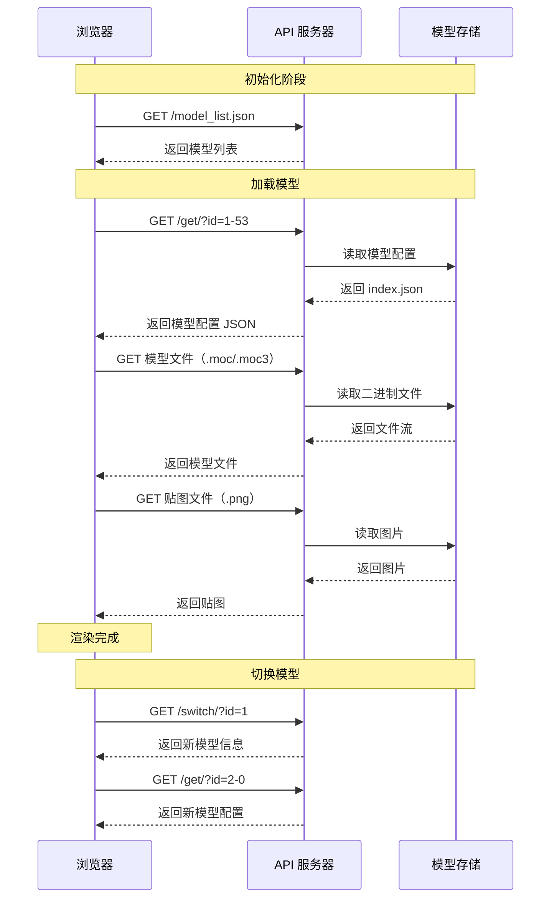
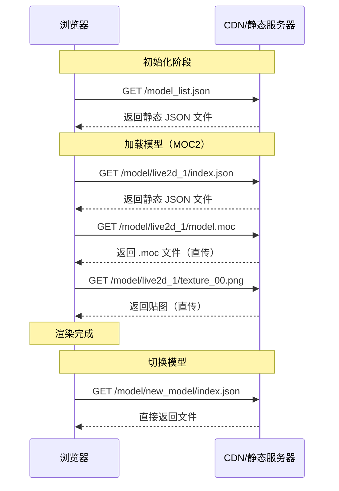
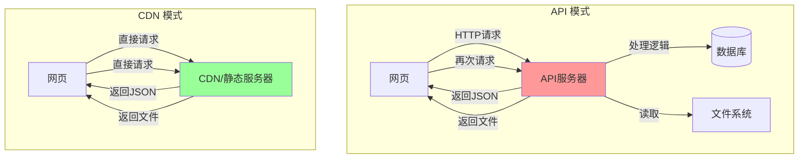
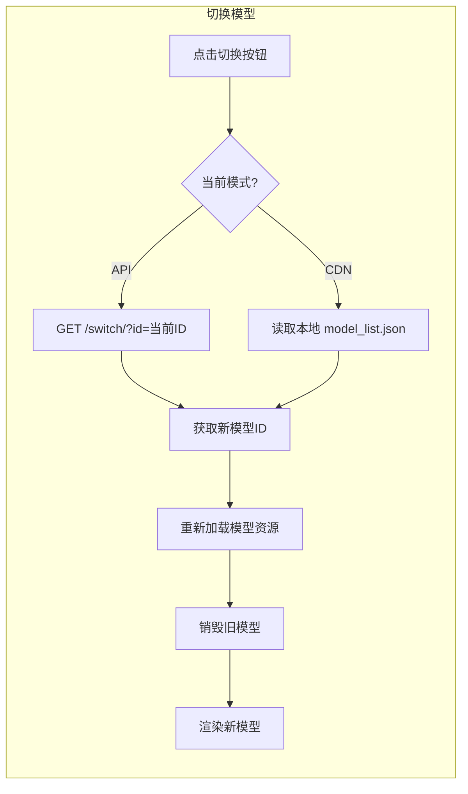

> 上一次做看板娘后一直没更新了，闲来无事，把看板娘重新做了一遍，添加了新功能，支持Moc3的模型展示，以及互动，添加了自定义参数的看板娘 canvas 画布大小加载，有些比较大的模型就可以展示完整了。
🎉 快去为你的网站添加一位可爱的看板娘吧！

<link rel="stylesheet" href="https://npm.elemecdn.com/font-awesome@4.7.0/css/font-awesome.min.css">


## ✨ 主要功能

| 功能              | 说明                                       |
| :---------------- | :----------------------------------------- |
| 🎭 Live2D 展示 | 支持 Cubism2（MOC2）和 Cubism4（MOC3）模型 |
| 💬 智能对话    | 根据时间、节日、用户行为显示不同消息       |
| 🎮 内置小游戏  | 飞机大战等小游戏，点击即可游玩             |
| 👗 换装系统    | 切换不同皮肤/服装，随心换装                |
| 🔄 多模型切换  | 切换不同的看板娘角色，不止一个             |

------

## 🚀 快速开始

- 在你的 HTML 页面的 `</body>` 标签前添加以下代码即可

```html
<!-- 看板娘引入-->
<script src="资源地址/init.js" data-side="left" apiPath="资源地址/live2d_api/"></script>
```

- handsome用户；主题设置 → 开发者设置 → 自定义输出 body 尾部的HTML代码

- 其他博客或网站；同样的方式，自定义输出 body 尾部的HTML代码
🟠注意：如果网站启用了 PJAX，看板娘不必每页刷新，因此要注意将代码放到 PJAX  刷新区域之外。

---

[collapse status="false" title="方式一：使用本站资源（推荐新手）"]

- 通过演示配置页面引入 [演示配置页][1] 

[/collapse]

---

[collapse status="false" title="方式二：自己部署前端资源"]

下载[资源包][2]前端资源包，目录结构如下：然后同样引入 init.js 即可

```bash
live2d/
├── init.js                     # 入口文件
├── waifu.min.css               # 样式文件
├── waifu-app.min.js            # 应用逻辑
├── waifu-bundle.min.js         # 核心模块
├── waifu-tips.min.json         # 对话配置
├── live2d.min.js               # Cubism2 运行时
├── live2dcubismcore.min.js     # Cubism Core
├── pixi.min.js                 # PixiJS 渲染引擎
├── cubism4.min.js              # Cubism4 扩展
└── asteroids.js                # 飞机大战游戏
```
[/collapse]

---

📌 init.js 支持的参数、data-side必须参数、apiPath/cdnPath 必须参数，2选1

| 参数        | 说明               | 示例                                   |
| :---------- | :----------------- | :------------------------------------- |
| apiPath   | API 模型服务器地址 | apiPath=//api.tiax.cn/live2d_api/   |
| cdnPath   | CDN 模型资源地址   | cdnPath=//api.tiax.cn/live2d_api/    |
| data-side | 看板娘位置         | data-side=right / left（可选左右） |

------

## 👋互动按钮

看板娘 waifu-tool  工具栏 共有 7 个互动按钮，默认隐藏，鼠标移动到人物上显示，可以通过进阶配置控制显隐。

<span class="fa fa-lg fa-comment"></span>&nbsp;&nbsp;调用一言 API，在头顶对话框随机发言  [Hitokoto - 一言](https://hitokoto.cn/) 

<span class="fa fa-lg fa-paper-plane"></span>&nbsp;&nbsp; JavaScript 小游戏，页面弹出一个小飞机，发射子弹消除当前页面上的元素，<kbd>空格</kbd> 发射子弹，<kbd>⬆️</kbd> <kbd>⬇️</kbd> <kbd>⬅️</kbd> <kbd>➡️</kbd> 控制移动

<span class="fa fa-lg fa-user-circle"></span>&nbsp;&nbsp;顺序切换人物模型，到最后一个模型就循环

<span class="fa fa-lg fa-street-view"></span>&nbsp;&nbsp;随机切换人物衣服，点了没反应就说明只有一套衣服哟

<span class="fa fa-lg fa-info-circle"></span>&nbsp;&nbsp;关于，作者信息

<span class="fa fa-lg fa-camera-retro"></span>&nbsp;&nbsp;拍照，截图当前人物后保存 png 格式图片，图片大小为当前的人物容器大小。

<span class="fa fa-lg fa-times"></span>&nbsp;&nbsp;隐藏看板娘，隐藏后可通过页面左下角按钮呼出。

---


## ⚙️ 进阶配置

### 1. 工具按钮配置

在 `init.js` 第 48 行附近可以配置工具按钮的显示顺序和内容：

```javascript
widgetOptions = {
    tools: ["hitokoto", "asteroids", "switch-model", "switch-texture", "photo", "info", "quit"]
};
```

| 工具名称         | 功能                 |
| :--------------- | :------------------- |
| hitokoto       | 获取一言（每日一句） |
| asteroids      | 飞机大战小游戏       |
| switch-model   | 切换看板娘角色       |
| switch-texture | 切换皮肤/服装        |
| photo          | 截图保存看板娘       |
| info           | 作者信息链接         |
| quit           | 隐藏看板娘           |

---


### 2. 模型尺寸配置

在 `waifu-tips.min.json` 中配置不同模型的显示尺寸，切换模型时会按指定大小加载。

```json
{
  "model_sizes": {
    "ALL": { "width": 800, "height": 800 },                    // 默认大小
    "live2d_1": { "width": 800, "height": 1400 },               // 指定某个模型文件夹下所有模型的大小
    "live2d_moc3/2": { "width": 800, "height": 1200 }          // 指定某个具体模型的大小
  }
}
```

---


### 3. 响应式控制

默认情况下，屏幕宽度小于 768px 时不会显示看板娘（模型没有做屏幕缩放适配）。修改 `init.js` 第 44 行附近：

```javascript
// 原代码
if (screen.width >= 768) {
}

// 修改为始终显示
if (true) {
}

// 或修改显示阈值
if (screen.width >= 480) {
}
```

---


### 4. 添加新的互动事件

在 `waifu-tips.min.json` 中添加新的选择器和对话：

```json
{
  "mouseover": [
    {
      "selector": ".your-class",
      "text": ["这是自定义的提示文字"]
    }
  ]
}
```

---


### 5. 使用自己的模型

前端 `init.js` 支持 CDN 加载模型，纯静态资源，无需 API 服务器。

------

#### 📊 API 模式 vs CDN 模式

| 特性           | **API 模式**（`apiPath`） | **CDN 模式**（`cdnPath`） |
| :------------- | :------------------------ | :------------------------ |
| **原理**       | 通过后端接口动态获取模型  | 直接请求静态 JSON 文件    |
| **需要后端**   | ✅ 需要搭建 API 服务器     | ❌ 不需要，纯静态文件      |
| **模型存储**   | 放在自己的服务器上        | 放在 CDN / OSS / 静态目录 |
| **配置复杂度** | 🔴 较高，需要写接口        | 🟢 较低，直接放文件即可    |
| **灵活性**     | 高，可动态控制返回内容    | 低，只能返回已存在的文件  |
| **适用场景**   | 有后端、需要权限控制      | 静态博客、托管平台        |
| **引入参数**   | apiPath=                | cdnPath=                |

#### 🔄 API 模式工作流程



---

#### 🔄 CDN 模式工作流程



---

#### 🏗️ 架构对比



---

#### 🔄 模型切换流程




> API 模式：
> 浏览器 → “嘿服务器，给我模型1号的数据”
> 服务器 → “让我查查... 找到了，给你”
> 浏览器 → “谢谢！再给我这个模型的贴图”
> 服务器 → “好的，这是你要的文件”

> CDN 模式：
> 浏览器 → “我要读 models/model_1/index.json 这个文件”
> 服务器 → “喏，文件在这”
> 浏览器 → “再给我 texture_00.png”
> 服务器 → “给你”

API 搭建可以参考这个项目：https://github.com/fghrsh/live2d_api

------

#### 📁 CDN 模式纯静态部署指南

💡 简单说：不需要后端服务器，不需要数据库，纯文件就能跑，目录结构如下

```bash
live2d_models/                          # 👈 模型资源根目录
│
├── model_list.json                     # 📋 模型列表配置
│                                       
└── model/                              # 📦 模型文件夹
    │
    ├── live2d_1/                       # 🎭 Cubism2 模型示例
    │   ├── index.json                  #   模型配置（必须）
    │   ├── model.moc                   #   模型二进制文件
    │   ├── textures/                   #   贴图目录
    │   │   ├── texture_00.png          
    │   │   └── texture_01.png          #   多套皮肤
    │   ├── motions/                    #   动作文件
    │   │   ├── idle_01.mtn
    │   │   ├── idle_02.mtn
    │   │   └── tap_body_01.mtn
    │   ├── expressions/                #   表情文件
    │   │   ├── normal.exp.json
    │   │   └── smile.exp.json
    │   ├── physics.json                #   物理效果
    │   └── pose.json                   #   姿势配置
    │
    ├── live2d_2/                       # 🎭 另一个 Cubism2 模型
    │   ├── index.json
    │   ├── model.moc
    │   └── textures/
    │       └── texture_00.png
    │
    └── live2d_moc3/                    # 🤖 Cubism4/MOC3 模型
        │
        ├── haru/                       #   Haru 模型
        │   ├── index3.json             #   MOC3 配置（必须）
        │   ├── Haru.moc3               #   模型文件
        │   ├── Haru.1024/              #   贴图（注意文件夹名）
        │   │   └── texture_00.png
        │   ├── Haru.physics3.json      #   物理效果
        │   ├── Haru.pose3.json         #   姿势
        │   ├── motions/                #   动作
        │   │   ├── idle_01.motion3.json
        │   │   └── tapBody_01.motion3.json
        │   └── expressions/            #   表情
        │       ├── f01.exp3.json
        │       └── f02.exp3.json
```

#### 📝 各文件作用

| 文件/文件夹       | 作用                         | 比喻           |
| :---------------- | :--------------------------- | :------------- |
| live2d_models/  | 模型资源的大仓库             | 就像一个衣柜   |
| model_list.json | 衣柜里的清单，写着有哪些衣服 | 衣柜门上的目录 |
| model/          | 衣柜里挂衣服的地方           | 衣柜的挂衣杆   |

#### 📄 model_list.json 文件说明

```json
{
  "models": [
    ["live2d_1"],              // 第1个模型 → 去 model/live2d_1/ 文件夹找
    ["live2d_moc3/haru"]       // 第2个模型 → 去 model/live2d_moc3/haru/ 找
  ],
  "messages": [
    "你好呀，我是看板娘1号～",    // 对应第1个模型切换时的欢迎语
    "Hello！我是 Haru 酱！"      // 对应第2个模型切换时的欢迎语
  ]
}
```

- `models`：二维数组，第一层是模型列表，第二层是该模型的皮肤列表
- `messages`：切换到对应模型时显示的欢迎语

> ⚠️ **重点**：`"live2d_1"` 填的是**文件夹路径**，不是文件名。程序会自动去 `model/live2d_1/` 文件夹里找 `index.json`（MOC2 模型）或 `index3.json`（MOC3 模型）

------

#### ❓自建模型常见问题

[collapse status="false" title="FAQ"]

**Q1：模型文件去哪下载？**

- 官网：https://www.live2d.com/download/sample-data/
- 下载后把文件按上面的目录结构放置即可
---

**Q2：`live2d_1` 这个名字能改吗？**

- 可以。只要 `model_list.json` 里的名字和文件夹名字保持一致即可。
---

**Q3：怎么知道模型是 MOC2 还是 MOC3？**

- 文件后缀是 `.moc` → MOC2（老版本）
- 文件后缀是 `.moc3` → MOC3（新版本）
---

**Q4：我没有后端服务器怎么办？**
- 这就是 CDN 模式的优点——不需要后端，只要能把文件放到网上就行
- ☁️ 云厂商的对象存储（阿里云 OSS、腾讯云 COS、七牛云等）
- 📦 静态托管平台（GitHub Pages、Vercel、Netlify 等）
- 🖥️ 任何支持静态文件访问的服务器

[/collapse]


----
## 📝更新记录

[timeline title="看板娘更新记录" type="small"]
[item date="2020-05-06"]  内容: 修复后端接口初始化，看板娘模型下方有 1CM 间隔 [/item]
[item date="2020-05-30"]  内容：随着接口访问量日益巨大，截止 5 月底，已经请求了 600 万次了 ::aru:dead:: 服务器负载天天 90% ,为了满足大家的需要，现在把接口数据都缓存在百度云 CDN 的，刷新时间 2h ，缓存生效后可以达到毫秒换装，请自己体验 [/item]
[item date="2020-05-30"]  内容：优化CND换装，重构前端模型，现在的模型看起来效果更精细 [/item]
[item date="2020-10-29"]  内容：修复在某些博客隐藏看板娘后，左侧召唤按钮被遮挡的  BUG  [/item]
[item date="2022-03-10"]  内容：优化接口速度，精简代码，新增模型 10+ 模型[/item]
[item date="2023-05-19"]  内容：换域名了，给之前的调用者说声抱歉，域名突然掉备案的 ，希望你们能看到这个新的地方[/item]
[item date="2023-11-17"]  内容：域名备案掉了，服务器也到期了，重新恢复。[/item]
[item date="2024-05-31"]  内容：重写前端代码，模型看起来更精细，即使放大也不会模糊[/item]
[item date="2026-05-9"]  内容：整体重构新版本 1.0.0 [/item]

[/timeline]


## 📄 许可证

本项目仅供学习和交流使用，Live2D 相关版权归 Live2D 公司所有。
API 内所有模型 版权均属于原作者，仅供研究学习，不得用于商业用途


------

## 🔗 相关链接

- [Live2D 官方网站](https://www.live2d.com/)
- [live2d-widget][3]

------

## 📞 支持与反馈

- 👨‍💻 如有问题或建议，欢迎在「ISSUER」

---


  [1]: https://api.tiax.cn/live2d.html
  [2]: https://p.tiax.cn/T/live2d.rar
  [3]: https://github.com/stevenjoezhang/live2d-widget
